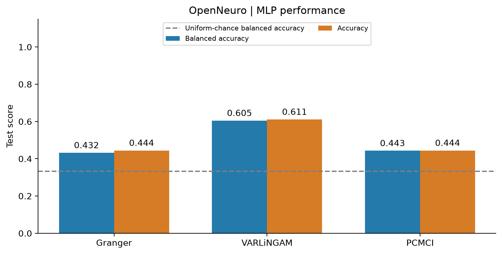
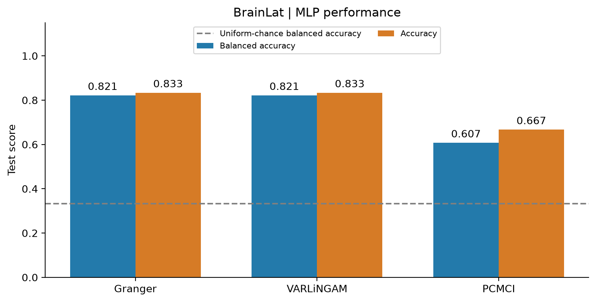

# EEG Graphs for AD, CN and FTD Classification

Transforming resting-state EEG recordings into subject-level graphs and comparing **Granger causality**, **VARLiNGAM** and **PCMCI** for three-class classification with a PyTorch MLP.

Computer Vision project by **Michele Arrigoni**.

[](.python-version)
[](https://pypa.github.io/uv/)
[](LICENSE)

## Overview

Each subject is represented by 19 EEG channels, eight features per channel and a directed connectivity matrix. The target classes are:

| Label | Class | Description |
| --- | --- | --- |
| 0 | CN | Healthy controls |
| 1 | AD | Alzheimer's disease |
| 2 | FTD | Frontotemporal dementia |

The project implements EEG preprocessing, graph construction, descriptive connectivity analysis and an MLP baseline. The exported graphs can support future graph neural network experiments; the reported classifier is an MLP.

Here, *causal* refers to model-based directional dependencies under each estimator's assumptions. An EEG graph edge does not establish a direct physiological pathway.

## Results

The saved experiments evaluate **OpenNeuro and BrainLat separately**, using subject-level stratified splits and seed 42. Balanced accuracy is the mean recall across the three classes.

| Dataset | Connectivity | Balanced accuracy | Accuracy |
| --- | --- | ---: | ---: |
| OpenNeuro | Granger | 0.432 | 0.444 |
| OpenNeuro | VARLiNGAM | **0.605** | **0.611** |
| OpenNeuro | PCMCI | 0.443 | 0.444 |
| BrainLat | Granger | **0.821** | **0.833** |
| BrainLat | VARLiNGAM | **0.821** | **0.833** |
| BrainLat | PCMCI | 0.607 | 0.667 |





Sources: [OpenNeuro results](results/mlp/openneuro/classifier_results.json), [BrainLat results](results/mlp/brainlat/classifier_results.json) and their dataset-specific `run_config.json` files.

Each test set contains only 18 subjects. These are single-split, within-dataset results, without confidence intervals or an external-dataset evaluation. They do not establish cross-dataset generalization or statistically significant superiority of one method. Feature-only and adjacency-only ablations remain future work.

## Pipeline

1. **Load and align channels.** Read EEGLAB recordings and enforce a common 19-channel order. The BrainLat adapter maps available electrodes to the canonical channel set.
2. **Preprocess EEG.** Apply a 0.5–40 Hz band-pass filter, a 50 Hz notch and resampling to 100 Hz. Split recordings into non-overlapping five-second epochs.
3. **Control quality.** Reject invalid, extreme-amplitude or nearly flat epochs, then standardize each channel. Retain a shared number of accepted epochs within each dataset.
4. **Extract node features.** Compute five Welch band powers plus mean, standard deviation and variance from standardized signals before differencing.
5. **Estimate connectivity.** Use ADF/KPSS checks and up to two differencing steps for connectivity inputs, then estimate Granger, VARLiNGAM and PCMCI matrices. Aggregate across epochs and export directed and symmetric variants.
6. **Classify subjects.** Concatenate 152 node-feature values and 342 off-diagonal directed edge weights into a 494-dimensional MLP input.

The saved MLP architecture is `494 → 32 → 3`, with ReLU and dropout 0.1. Training uses AdamW, learning rate 0.005, weight decay 0.0001, class-weighted cross-entropy, at most 500 epochs and early-stopping patience 50. Input standardization uses training subjects only; validation loss selects the checkpoint.

## Data availability

**The `dataset/` and `brainlat_dataset/` folders are local-only and are not included in this repository.** Cloning the repository does not download EEG recordings.

Generated subject arrays and graph objects under `data_hgcn_ready/` are also excluded by `.gitignore`. Small configuration files and summaries can be tracked. You can inspect the saved results and figures without the raw data, but training and full figure regeneration require local processed exports.

| Processed dataset | CN | AD | FTD | Total | Accepted epochs per subject |
| --- | ---: | ---: | ---: | ---: | ---: |
| OpenNeuro | 29 | 36 | 22 | 87 | 61 |
| BrainLat | 32 | 35 | 18 | 85 | 28 |

The reported exports exclude OpenNeuro `sub-086` and BrainLat `sub-078`, as configured in [code/config.py](code/config.py). The two datasets differ in acquisition conditions, retained duration and electrode geometry. Channel mapping does not make their acquisition geometries identical.

### Prepare local recordings

- **OpenNeuro:** [code/ds_downloader.ipynb](code/ds_downloader.ipynb) targets dataset `ds004504`. Run the notebook with the repository root as its working directory. Set `CONFIG["derivatives_dir"]` to the directory containing the downloaded subject folders; the project currently expects `dataset/openneuro_derivatives/`.
- **BrainLat:** obtain the EEG data through its original distribution on Synapse, subject to the provider's access requirements. The acquisition helper references entity `syn51549340`. Place the EEG files under `brainlat_dataset/EEG data/`, or supply another path to the adapter. Authentication credentials are personal and must not be committed.

The preprocessing loader expects one `*_eeg.set` file in each subject's `eeg/` directory, together with its companion data file when applicable:

```text
dataset/
├── openneuro_derivatives/
│   └── sub-001/eeg/sub-001_task-eyesclosed_eeg.set
└── brainlat_derivatives/                 # Created by the adapter
    └── sub-001/eeg/sub-001_task-eyesclosed_eeg.set

brainlat_dataset/
└── EEG data/                            # Locally obtained BrainLat files
```

The label mapping in `preprocessing.py` is specific to the OpenNeuro subject numbering. The BrainLat adapter assigns compatible identifiers. Other datasets require an explicit label mapping.

## Installation

Use **Python 3.12** (specified in `.python-version`). The project environment is managed with `uv` and described by [pyproject.toml](pyproject.toml) and `uv.lock`.

The dependency configuration currently pins **Windows AMD ROCm wheels**, including PyTorch `2.9.1+rocm7.2.1`. It is not a platform-neutral environment specification. On the matching platform, run from the repository root:

```powershell
uv sync
```

For a different platform or PyTorch backend, adapt the ROCm dependencies and `[tool.uv.sources]` entries in a local environment configuration before installation.

Figure generation additionally imports Matplotlib, which is available as a dependency but not currently declared in `pyproject.toml`:

```powershell
uv pip install matplotlib
```

The OpenNeuro download notebook also requires a notebook-capable editor or Jupyter environment. Use the script entry points below to run the analysis; the package's console entry point does not launch the pipeline.

## Console script

The project defines a console script in `pyproject.toml`:

```powershell
uv run progetto-computer-vision
```

This invokes `progetto_computer_vision:main` from the `src/progetto_computer_vision/` package, which currently prints a greeting. Extend the `main()` function in `src/progetto_computer_vision/__init__.py` to launch the pipeline.

## Run the project

Run all commands from the repository root.

### 1. Convert BrainLat recordings

Inspect the discovered subjects before conversion:

```powershell
uv run python code/brainlat_adapter.py --brainlat-root "brainlat_dataset/EEG data" --dry-run
uv run python code/brainlat_adapter.py --brainlat-root "brainlat_dataset/EEG data"
```

The adapter writes to `dataset/brainlat_derivatives/` by default. It skips existing converted recordings unless `--overwrite` is supplied.

### 2. Build graph exports

Edit the following entries in [code/config.py](code/config.py) for **one dataset at a time**:

| Configuration key | OpenNeuro | BrainLat |
| --- | --- | --- |
| `derivatives_dir` | `PROJECT_ROOT / "dataset" / "openneuro_derivatives"` | `PROJECT_ROOT / "dataset" / "brainlat_derivatives"` |
| `output_dir` | `PROJECT_ROOT / "data_hgcn_ready" / "openneuro"` | `PROJECT_ROOT / "data_hgcn_ready" / "brainlat"` |

For each configuration, run:

```powershell
uv run python code/main.py
```

Each processed subject folder contains `X.npy`, directed and symmetric adjacency files for each method, `preprocessed_epochs.npy`, `y.json` and `metadata.json`. Dataset-level files include configuration, summaries, splits and serialized graphs. The MLP creates its own subject split rather than consuming the exported `splits.json`.

Use clean export directories when rebuilding a cohort: the MLP loader reads every subject folder present, so stale or excluded subject folders must not remain in the training inputs.

### 3. Evaluate the datasets separately

The current CLI writes every run to `results/mlp/classifier_results.json`. **Save that output after each run** to avoid replacing the previous dataset's results. Supplying multiple `--dataset-dir` arguments to a single invocation pools those datasets and does not reproduce the separate experiments above.

The following PowerShell commands set one PyTorch CPU thread, matching the saved run configurations, and preserve each output:

```powershell
uv run python -c "import runpy, torch; torch.set_num_threads(1); runpy.run_path('models/mlp.py', run_name='__main__')" --dataset-dir data_hgcn_ready/openneuro --seed 42
New-Item -ItemType Directory -Force results/mlp/openneuro
Copy-Item results/mlp/classifier_results.json results/mlp/openneuro/classifier_results.json

uv run python -c "import runpy, torch; torch.set_num_threads(1); runpy.run_path('models/mlp.py', run_name='__main__')" --dataset-dir data_hgcn_ready/brainlat --seed 42
New-Item -ItemType Directory -Force results/mlp/brainlat
Copy-Item results/mlp/classifier_results.json results/mlp/brainlat/classifier_results.json
```

These commands replace the corresponding saved result JSONs. The current CLI does not regenerate `run_config.json`; update that metadata if you change the model, environment or training parameters. Exact reproduction also requires the same processed subjects and inputs.

### 4. Refresh figures and report tables

With both processed datasets and their separate result JSONs available:

```powershell
uv run python code/update_report_figures.py
```

This script reads the existing exports and saved predictions, regenerates PDF/PNG figures and updates the generated tables in the LaTeX report. It does **not** retrain the models. Review the report's prose and hyperparameter descriptions whenever experiments change; the current figure script does not refresh all narrative statements.

## Repository guide

| Path | Contents |
| --- | --- |
| [code/config.py](code/config.py) | Dataset paths, channel order and preprocessing settings |
| [code/main.py](code/main.py) | Preprocessing and graph-export pipeline |
| [code/preprocessing.py](code/preprocessing.py) | Signal processing and node features |
| `code/*_causality.py` | Granger, VARLiNGAM and PCMCI estimators |
| [code/dataset_module.py](code/dataset_module.py) | Graph normalization and serialization |
| [code/brainlat_adapter.py](code/brainlat_adapter.py) | BrainLat conversion and electrode mapping |
| [models/mlp.py](models/mlp.py) | Baseline training and evaluation |
| [results/mlp/](results/mlp/) | Saved evaluation results and run metadata |
| [figures/](figures/) | Connectivity plots, classifier scores and confusion matrices |
| [docs/report_sintetico_en.tex](docs/report_sintetico_en.tex) | Full English report, methods, results and references |
| [docs/CHEATSHEET.md](docs/CHEATSHEET.md) | Italian code and library guide |
| [docs/mappatura_elettrodi_brainlat_openneuro.md](docs/mappatura_elettrodi_brainlat_openneuro.md) | Electrode-mapping notes |
| [src/progetto_computer_vision/](src/progetto_computer_vision/) | Python package with console entry point |
| [pyproject.toml](pyproject.toml) | Project configuration and dependencies (uv) |
| [uv.lock](uv.lock) | Pinned dependency resolution |
| [.python-version](.python-version) | Python version requirement (3.12) |
| [.gitignore](.gitignore) | git ignore patterns |

## Interpretation and next steps

Connectivity plots summarize class-average graphs. Their display threshold is the 80th percentile within each dataset and method, shared across classes. It is a visualization cutoff, not a significance test, and it is not applied to MLP inputs. Different estimators also assign different meanings to their edge weights.

Further evaluation should include repeated subject-level splits, feature/adjacency ablations, external-dataset testing and comparison with graph neural models. See the [report](docs/report_sintetico_en.tex) for estimator assumptions, methodological limitations and the bibliography.