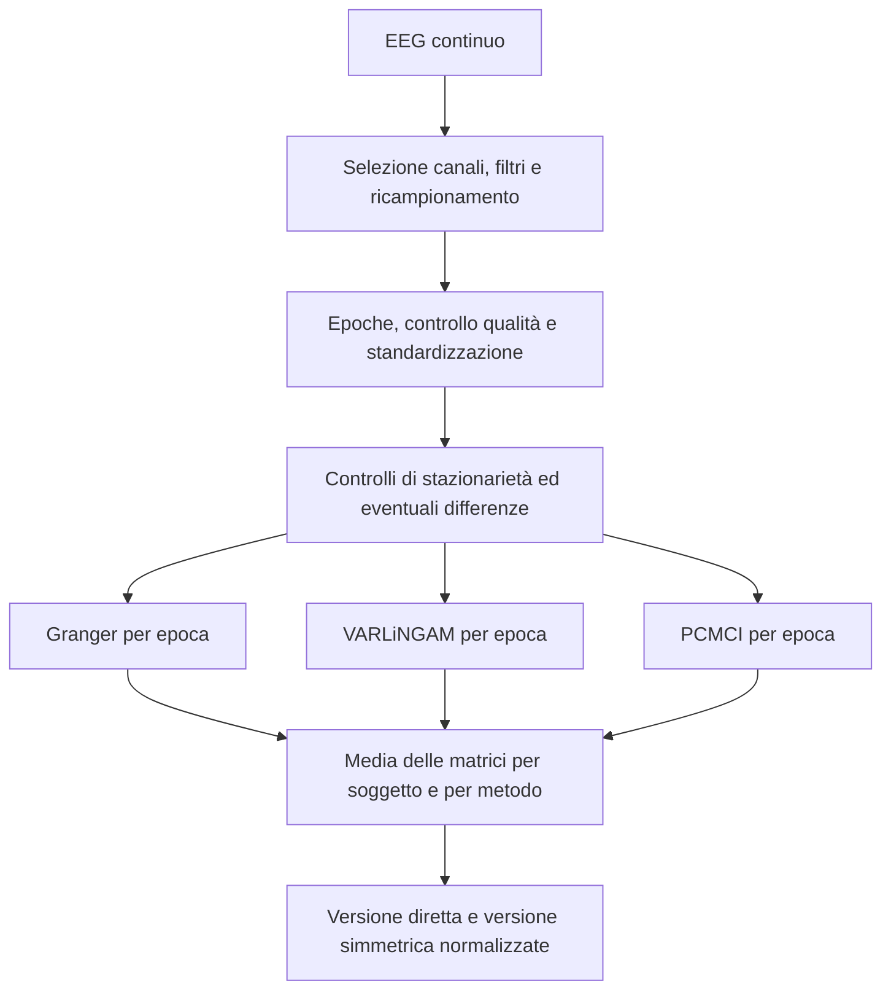

# Granger, VARLiNGAM e PCMCI: teoria, implementazione e motivazioni

Documento di approfondimento del progetto EEG → grafi, basato sui file presenti nel workspace il **16 settembre 2026**, comprese le modifiche locali non ancora registrate in Git.

L'obiettivo è spiegare che cosa stimano i tre metodi, come il codice trasforma le loro uscite in matrici di adiacenza e quali conseguenze hanno le scelte implementative. Le **motivazioni esplicite** sono ricavate dai commenti; le **motivazioni interpretative** sono ragionamenti tecnici coerenti con il codice, non dichiarazioni attribuite all'autore. Non sono stati rieseguiti gli esperimenti sui dataset: questo documento è un'analisi statica, accompagnata dalla verifica dei sorgenti delle librerie installate.

## 1. Mappa di lettura e file analizzati

| Argomento | File e punti di ingresso |
|---|---|
| Granger | [granger_causality.py](../code/granger_causality.py): `_compute_granger_epoch`, riga 18; `compute_granger_adjacency`, riga 99 |
| VARLiNGAM | [lingam_causality.py](../code/lingam_causality.py): `_compute_lingam_epoch`, riga 17; `compute_lingam_adjacency`, riga 77 |
| PCMCI | [pcmci_causality.py](../code/pcmci_causality.py): `_compute_pcmci_epoch`, riga 29; `compute_pcmci_adjacency`, riga 111 |
| Parametri | [config.py](../code/config.py): dizionario `CONFIG` |
| Preparazione dei segnali | [preprocessing.py](../code/preprocessing.py): `make_epoch_stationary`, riga 200; `preprocess_epochs_for_subject`, riga 323 |
| Collegamento dei moduli | [main.py](../code/main.py): `compute_graphs`, riga 28; `main`, riga 83 |
| Trasformazione del grafo | [dataset_module.py](../code/dataset_module.py): `prepare_adjacency_for_hgcn`, riga 16 |

Le righe si riferiscono alla versione esaminata e possono cambiare con successive modifiche. Sono state rilevate queste versioni nell'ambiente `.venv`: `lingam 1.12.2`, `statsmodels 0.15.0`, `tigramite 5.2.10.1`, `numpy 2.5.3`, `joblib 1.6.0`. I dettagli dei default riportati sotto sono stati controllati nei sorgenti locali, perché la documentazione online può descrivere versioni diverse.

## 2. Il problema comune: da serie temporali a grafi diretti

Per ogni soggetto il progetto dispone di più epoche EEG. Un'epoca è una matrice con forma:

$$
X^{(e)}\in\mathbb{R}^{N\times T},
$$

dove $N$ è il numero di canali e $T$ il numero di campioni. L'intero soggetto è rappresentato da un tensore con forma `(n_epochs, n_channels, n_timepoints)`.

I tre metodi producono un grafo per epoca e poi una matrice media per soggetto. La convenzione comune è:

$$
A[i,j]=\text{peso dell'arco }j\rightarrow i.
$$

**La riga è la destinazione, la colonna è la sorgente.** Ad esempio, `A[1, 0] > 0` indica una relazione da `Fp1` a `Fp2`, se si usa l'ordine configurato. Questa convenzione rende naturale l'aggregazione `A @ H`: il nodo della riga riceve contributi dai nodi delle colonne. Un'eventuale conversione in liste di archi deve comunque rispettare la convenzione richiesta dalla libreria a valle.



I pesi hanno significati differenti: Granger usa evidenza statistica trasformata, VARLiNGAM usa coefficienti strutturali in valore assoluto e PCMCI usa correlazioni parziali in valore assoluto. L'identica forma delle matrici non implica un'identica unità di misura.

### 2.1 Che cosa significa «causale» in questa analisi

Una relazione temporale osservata non equivale automaticamente all'effetto di un intervento. Granger identifica un miglioramento predittivo; VARLiNGAM mira a identificare un modello strutturale sotto ipotesi specifiche; PCMCI ricerca dipendenze condizionali compatibili con archi causali sotto le proprie assunzioni.

Nel progetto i nodi sono **canali EEG**. Interpretare un arco come connessione diretta tra popolazioni neuronali richiederebbe ulteriori argomenti: il codice dei tre stimatori non ricostruisce sorgenti, non elimina confondenti non osservati e non verifica sperimentalmente gli effetti degli archi. La rimozione del lag zero, da sola, non dimostra l'assenza di mescolamento o confondimento nei segnali analizzati.

## 3. Preparazione dei dati e conseguenze metodologiche

### 3.1 Configurazione effettiva

| Parametro | Valore | Implicazione |
|---|---:|---|
| Canali | 19 | Matrici finali $19\times19$; 342 coppie dirette senza diagonale |
| `target_fs` | 100 Hz | Un campione corrisponde a 10 ms |
| Banda | 0,5–40 Hz | Definisce il contenuto spettrale dei segnali analizzati |
| `notch_freq` | 50 Hz | Notch applicato prima del ricampionamento |
| `epoch_length_sec` | 5 s | 500 campioni prima delle differenze |
| `maxlag` | 4 | Orizzonte massimo configurato di 40 ms |
| `alpha` | 0,01 | Usato da Granger e PCMCI con ruoli differenti |
| `max_diffs` | 2 | Fino a due differenze successive |
| `varlingam_criterion` | `bic` | Selezione dell'ordine VAR per epoca |
| `varlingam_prune` | `True` | Selezione sparsa dei coefficienti |
| `varlingam_include_instantaneous` | `False` | $B_0$ esclusa dall'aggregazione finale |
| `add_self_loops` | `False` | Nessun self-loop aggiunto dalla preparazione del grafo |

Il lag 4 significa quattro **campioni**, non quattro secondi. Inoltre ha un ruolo diverso nei tre metodi: ordine massimo dei test bivariati per Granger, ordine massimo candidato per VARLiNGAM e ritardo massimo dei collegamenti per PCMCI.

### 3.2 Filtri, epoche e standardizzazione

`filter_and_resample` applica band-pass, notch e ricampionamento. La motivazione esplicita del ricampionamento è ridurre memoria e costo di calcolo mantenendo la banda configurata. Ridurre la frequenza riduce però anche la risoluzione temporale: i risultati riguardano la rappresentazione a 100 Hz.

`split_in_epochs` crea finestre contigue senza sovrapposizione e scarta la coda incompleta. `CONFIG['overlap']` vale zero, ma la funzione non legge quel parametro: modificarlo non introdurrebbe automaticamente epoche sovrapposte.

Finestre di cinque secondi costituiscono, come motivazione interpretativa, un compromesso tra numerosità campionaria e possibilità che la dinamica rimanga relativamente stabile nella finestra. Non è presente, nei moduli esaminati, una validazione che dimostri l'ottimalità di questa durata.

`is_good_epoch` esclude valori non finiti, ampiezze assolute oltre `150e-6` e canali con deviazione standard inferiore a `1e-8`. Questo controllo precede lo z-score e opera nelle unità dei dati MNE, normalmente volt.

`zscore_epoch` trasforma ciascun canale separatamente:

$$
z_i(t)=\frac{x_i(t)-\bar{x}_i}{s_i+10^{-8}}.
$$

La normalizzazione rende più confrontabili le scale e facilita le regressioni. **Standardizzare non rende gaussiana la distribuzione** e non annulla quindi, da sola, la non gaussianità necessaria a LiNGAM. D'altro canto non garantisce che quella condizione sia soddisfatta.

### 3.3 Stazionarietà: intenzione descritta e comportamento reale

ADF ha come ipotesi nulla la presenza di una radice unitaria; nel codice passa se `p <= 0.05`. KPSS ha come ipotesi nulla la stazionarietà di livello; passa se `p > 0.05`. Non rifiutare un'ipotesi non equivale a dimostrarla: questi controlli sono indicatori statistici, non certificazioni.

La docstring di `make_epoch_stationary` afferma che ogni canale deve superare entrambi i test, ma l'istruzione effettiva è:

```python
if not (adf_ok or kpss_ok):
    non_stationary.append(ch)
```

Il criterio reale accetta un canale quando **almeno uno** dei due test passa. Di conseguenza:

| ADF passa | KPSS passa | Canale accettato dal codice |
|---|---|---|
| Sì | Sì | Sì |
| Sì | No | Sì |
| No | Sì | Sì |
| No | No | No |

Se almeno un canale non passa il criterio, `np.diff(current, axis=1)` differenzia **tutti** i canali dell'epoca, mantenendoli allineati:

$$
\Delta x_i(t)=x_i(t)-x_i(t-1).
$$

Dopo una o due differenze rimangono rispettivamente 499 o 498 campioni. Le epoche vengono poi tagliate alla lunghezza minima del soggetto. Al raggiungimento del limite, la funzione restituisce comunque l'epoca: `preprocess_epochs_for_subject` la conserva anche se qualche canale non supera ancora i controlli. Il report dettagliato è calcolato ma non viene aggiunto a `stationarity_report` né restituito nel `quality_report` finale.

Queste istruzioni non consentono di affermare che tutte le epoche consegnate agli stimatori siano stazionarie. Inoltre alcune epoche possono rappresentare livelli, altre incrementi, altre seconde differenze: la media finale può quindi combinare grafi stimati su trasformazioni diverse. È una conseguenza del codice, non una proprietà dei tre algoritmi.

Le soglie ADF/KPSS restano ai default 0,05: `CONFIG['alpha']=0.01` non è passato a queste funzioni. Anche il `maxlag=4` di ADF è un default locale; il valore coincide oggi con quello causale, ma i due parametri non sono collegati automaticamente.

### 3.4 Stessi dati tra metodi e tra soggetti

`compute_graphs` passa ai tre metodi lo stesso tensore elaborato. Le feature dei nodi, invece, sono costruite da `raw_good_epochs`, che contiene epoche standardizzate **prima** della differenziazione; il nome non indica dati completamente grezzi.

`main` determina il numero minimo di epoche valide tra i soggetti e usa `[:min_epochs]`. La motivazione esplicita è uniformare la quantità di osservazioni. Il messaggio a schermo parla di epoche equispaziate, ma vengono selezionate le **prime** epoche valide. Ciò scarta dati dei soggetti più lunghi e può privilegiare la parte iniziale delle registrazioni. PCMCI può poi usare meno epoche se alcuni worker falliscono.

## 4. Granger: fondamento teorico

### 4.1 Confronto tra due modelli predittivi

Per verificare se il canale sorgente $j$ aiuta a prevedere il canale destinazione $i$, si confrontano due regressioni. Per un ordine autoregressivo $p$, il modello ristretto è:

$$
x_i(t)=c_R+\sum_{k=1}^{p}a_kx_i(t-k)+\varepsilon_R(t).
$$

Il modello completo aggiunge il passato della sorgente:

$$
x_i(t)=c_U+\sum_{k=1}^{p}\tilde a_kx_i(t-k)
+\sum_{k=1}^{p}b_kx_j(t-k)+\varepsilon_U(t).
$$

L'ipotesi nulla è $H_0:b_1=\cdots=b_p=0$. Se viene rifiutata, il passato di $j$ aggiunge informazione predittiva rispetto al solo passato di $i$. La libreria usata esegue test su due serie, con la seconda colonna come possibile causa della prima. [Documentazione ufficiale di `grangercausalitytests`](https://www.statsmodels.org/stable/generated/statsmodels.tsa.stattools.grangercausalitytests.html).

### 4.2 Il test F usato nel progetto

Indichiamo con $SSR_R$ e $SSR_U$ le somme dei quadrati dei residui dei due modelli. Con $T$ campioni originali, $n=T-p$ osservazioni utilizzabili e intercetta, il modello completo ha $2p+1$ parametri. La statistica è:

$$
F=\frac{(SSR_R-SSR_U)/p}{SSR_U/[n-(2p+1)]}.
$$

Il numeratore misura il miglioramento per restrizione rimossa; il denominatore lo rapporta alla variabilità residua del modello completo. Il p-value è calcolato dalla distribuzione F prevista dal test. Il sorgente locale di statsmodels, funzione `grangercausalitytests`, implementa questa quantità nella voce `ssr_ftest`.

L'inferenza richiede un modello adeguato e condizioni sui residui; autocorrelazione residua, instabilità, dipendenze non lineari non rappresentate o regressori quasi collineari possono comprometterla. Il codice non aggiunge diagnostiche dei residui o della stabilità.

### 4.3 Causalità bivariata e causalità condizionata

L'implementazione è **pairwise**: nella regressione compaiono soltanto i due canali della coppia. Non è un test Granger multivariato condizionato sugli altri 17 canali.

Come esempio concettuale, se un terzo processo influenza sia $i$ sia $j$ con ritardi differenti, il passato di $j$ può aiutare a prevedere $i$ senza che esista una connessione diretta $j\rightarrow i$. Anche un percorso mediato può generare prevedibilità bivariata. Per questo gli archi vanno descritti come dipendenze predittive dirette nella rappresentazione del grafo, senza assumere automaticamente che siano effetti causali diretti del sistema reale.

## 5. Granger: analisi del codice e delle scelte

### 5.1 Elaborazione di una singola epoca

`_compute_granger_epoch` esegue questi passaggi:

1. Crea una matrice nulla `float32` e una lista di candidati.
2. Visita tutte le coppie ordinate `target, source`, escludendo la diagonale.
3. Scarta coppie con dati non finiti o un canale esattamente costante.
4. Costruisce `pair_data = np.column_stack((epoch[target], epoch[source]))`.
5. Chiama `grangercausalitytests(pair_data, maxlag=max_lag)`.
6. Estrae `results[lag][0]['ssr_ftest'][1]` per ogni ordine da 1 a `max_lag`.
7. Elimina i p-value non finiti e conserva il minimo della coppia.
8. Applica Benjamini–Hochberg ai minimi di tutte le coppie valide dell'epoca.
9. Assegna un peso solo alle coppie dichiarate significative.

Il controllo della diagonale riguarda l'output: il passato del target rimane indispensabile nella regressione. Il commento secondo cui un canale predice banalmente il proprio passato non è una giustificazione statistica precisa; la ragione operativa è rappresentare solo collegamenti tra canali distinti.

### 5.2 «Lag migliore» significa qui ordine migliore

Con `maxlag=4`, statsmodels valuta modelli di ordine 1, 2, 3 e 4. Il test all'ordine 4 verifica congiuntamente i coefficienti della sorgente ai ritardi 1–4. Non verifica soltanto il coefficiente al ritardo 4.

Di conseguenza il minimo selezionato non identifica il ritardo fisico di una connessione. Il codice non conserva nemmeno l'ordine che ha generato quel minimo. La formulazione «strongest lag-level p-value» nei commenti va letta con questa precisazione.

### 5.3 FDR e selezione del minimo

Per ogni coppia il codice costruisce:

$$
p^*_{ij}=\min_{1\leq p\leq L}p_{ij,p}.
$$

Benjamini–Hochberg ordina gli $m$ valori candidati e cerca il massimo indice $k$ tale che:

$$
p^*_{(k)}\leq\frac{k}{m}\alpha.
$$

La motivazione interpretativa è limitare i falsi ritrovamenti dovuti alle molte coppie. Tuttavia **la selezione del minimo tra ordini non è corretta prima di applicare BH**. Sotto l'ipotesi nulla, un minimo scelto da più p-value non è automaticamente un p-value valido per la coppia. Come illustrazione, con quattro test indipendenti a soglia 0,01, la probabilità che almeno uno dia `p < 0.01` è $1-0.99^4\approx3.94\%$; i test annidati effettivi sono dipendenti, quindi quel numero non quantifica il caso reale.

La procedura contiene una correzione tra coppie, ma non è corretto attribuirle automaticamente un controllo FDR globale all'1% sull'intera ricerca coppie–ordini. Anche le condizioni di dipendenza tra test contano per le garanzie di BH. Non c'è inoltre correzione comune tra epoche o soggetti.

Per una revisione metodologica si potrebbe valutare un p-value di coppia corretto per la ricerca sugli ordini, oppure definire a priori un ordine da testare. Sono possibili modifiche future, non operazioni già effettuate.

### 5.4 Significato del peso

Per una coppia accettata:

$$
A^{(e)}[i,j]=-\log_{10}\!\left(\max(p^*_{ij},10^{-12})\right).
$$

Esempi: $10^{-3}\mapsto3$, $10^{-6}\mapsto6$. Il limite inferiore sul p-value impedisce pesi infiniti e pone un massimo di 12 per epoca. Si usa il p-value **originario selezionato**, non quello aggiustato da BH: la correzione decide la presenza dell'arco, non il valore numerico assegnato.

Questa trasformazione rende più grande un'evidenza statistica più forte. Il peso non misura la grandezza del coefficiente né una percentuale di varianza spiegata, e dipende anche dalla quantità e qualità delle osservazioni. Non è la misura Granger basata sul logaritmo del rapporto delle varianze degli errori.

### 5.5 Media, costo e gestione degli errori

`compute_granger_adjacency` usa Joblib per distribuire le epoche e restituisce:

$$
\bar A_G=\frac1E\sum_{e=1}^{E}A_G^{(e)}.
$$

Gli zeri entrano nella media. Per esempio, un arco con peso 4 in 2 epoche su 10 e zero nelle altre produce 0,8: il peso medio combina persistenza ed evidenza nelle epoche attive. Non è un p-value aggregato e non viene sottoposto a un test finale per soggetto.

Con 19 canali e quattro ordini, si hanno fino a $19\cdot18\cdot4=1368$ risultati di test per epoca. Il costo cresce con epoche, coppie e regressioni per ordine. La parallelizzazione è sulle epoche, non sui singoli archi.

`ValueError` e `np.linalg.LinAlgError` nella chiamata della coppia fanno saltare quella coppia: il relativo zero non distingue assenza di significatività da fallimento. Altri tipi di eccezione possono propagarsi. Un input con zero epoche restituisce una matrice nulla.

## 6. VARLiNGAM: fondamento teorico

### 6.1 Un modello strutturale con effetti contemporanei e ritardati

VARLiNGAM combina un'autoregressione vettoriale e un modello strutturale lineare:

$$
\mathbf{x}_t=B_0\mathbf{x}_t+\sum_{k=1}^{p}B_k\mathbf{x}_{t-k}+\mathbf e_t.
$$

$B_0$ rappresenta effetti contemporanei; $B_k[i,j]$ rappresenta l'effetto strutturale diretto di $j$ al ritardo $k$ su $i$. Le ipotesi centrali includono linearità, errori strutturali indipendenti con non gaussianità sufficiente, assenza di cause comuni nascoste e aciclicità delle relazioni contemporanee. [Modello VARLiNGAM nella documentazione ufficiale](https://lingam.readthedocs.io/en/latest/tutorial/var.html).

L'aciclicità riguarda $B_0$: ordinando opportunamente le variabili, essa è strettamente triangolare. Sono invece compatibili feedback nel tempo, come $j_{t-1}\rightarrow i_t$ e $i_{t-1}\rightarrow j_t$. Un grafo finale collassato sui soli canali può quindi contenere cicli senza contraddire l'aciclicità contemporanea.

L'uso della non gaussianità permette l'identificazione del modello strutturale sotto le ipotesi del metodo, andando oltre l'informazione fornita dalla sola covarianza dei residui. Questo è il contributo teorico del lavoro originario sullo SVAR non gaussiano. [Hyvärinen et al., 2010](https://www.jmlr.org/beta/papers/v11/hyvarinen10a.html).

### 6.2 Dalla forma ridotta alla forma strutturale

Riordinando l'equazione:

$$
\mathbf{x}_t=\sum_{k=1}^{p}M_k\mathbf{x}_{t-k}+\mathbf u_t,
\qquad
M_k=(I-B_0)^{-1}B_k,
\qquad
\mathbf u_t=(I-B_0)^{-1}\mathbf e_t.
$$

Il procedimento eseguito dalla libreria locale può essere letto così:

1. Stima un VAR sui canali osservati, ottenendo $M_k$ e residui $\mathbf u_t$.
2. Applica DirectLiNGAM ai residui per stimare struttura contemporanea e ordine causale.
3. Ricostruisce $B_k=(I-B_0)M_k$.
4. Se richiesto, seleziona e ristima coefficienti tramite pruning.

Questa sequenza è verificabile in `.venv/Lib/site-packages/lingam/var_lingam.py`, metodi `fit`, `_estimate_var_coefs`, `_calc_b` e `_pruning`.

DirectLiNGAM cerca in modo sequenziale una variabile compatibile con un ruolo esogeno, sfruttando l'indipendenza tra tale variabile e i residui delle regressioni delle altre variabili su di essa. Dopo averne rimosso il contributo, ripete la procedura per ricostruire l'ordine. È questa componente che affronta l'orientamento contemporaneo; l'ordine temporale fornisce invece l'orientamento dei legami ritardati.

### 6.3 Coefficienti diretti ed effetti totali

$B_k[i,j]$ è un coefficiente strutturale, non l'effetto totale lungo tutti i percorsi del sistema. Se esiste anche un percorso mediato $j\rightarrow h\rightarrow i$, esso contribuisce alla propagazione complessiva ma non coincide con il coefficiente diretto $B_k[i,j]$.

Il progetto aggrega coefficienti diretti in valore assoluto; non calcola risposte all'impulso né usa `estimate_total_effect`. Dopo l'aggregazione il peso perde anche l'associazione a un singolo ritardo.

## 7. VARLiNGAM: analisi del codice e delle scelte

### 7.1 Trasposizione e costruzione del modello

Il wrapper parte da `epoch.T`, perché la libreria vuole `(osservazioni, variabili)`, quindi `(T, N)`. Il costruttore è:

```python
model = lingam.VARLiNGAM(
    lags=CONFIG['maxlag'],
    criterion=CONFIG['varlingam_criterion'],
    prune=CONFIG['varlingam_prune'],
)
model.fit(data)
```

Tutti i canali sono stimati congiuntamente. Rispetto al modello pairwise, ciò permette di rappresentare dipendenze condizionate sulle altre variabili osservate, al prezzo di più parametri e ipotesi strutturali più forti.

### 7.2 BIC: quattro è un massimo, non un ordine fisso

Nel sorgente installato `_estimate_var_coefs` prova gli ordini da 1 a `lags`, usa `trend='n'` e sceglie il minimo criterio. Con la configurazione corrente ogni epoca può quindi avere un ordine diverso fra 1 e 4; l'ordine zero non è candidato in questo ramo della libreria.

In termini generali il BIC combina adattamento e complessità:

$$
\mathrm{BIC}=-2\log\hat{\mathcal L}+q\log n,
$$

con $q$ parametri e $n$ osservazioni; per il VAR la libreria utilizza la sua espressione basata sulla covarianza residua. La motivazione interpretativa è evitare che un ordine maggiore venga preferito solo perché adatta meglio il campione.

Con 19 variabili e ordine 4, ogni equazione della forma ridotta contiene 76 regressori ritardati e il sistema ha 1444 coefficienti ritardati. BIC e pruning affrontano aspetti diversi della complessità: il primo seleziona l'ordine, il secondo i coefficienti. Non garantiscono, da soli, una stima accurata su ogni epoca.

`trend='n'` significa assenza di intercetta nel VAR stimato internamente. Lo z-score rende sensata questa scelta per i livelli centrati, ma viene applicato prima delle differenze: la media delle serie effettivamente passate al VAR non è necessariamente zero.

### 7.3 DirectLiNGAM e pruning

Non essendo passato un `lingam_model`, la versione installata istanzia `DirectLiNGAM()`. Non va dunque descritta questa specifica esecuzione come una chiamata a ICA-LiNGAM.

Con `prune=True`, la libreria usa regressioni adaptive Lasso: i predittori contemporanei sono vincolati dall'ordine stimato, mentre quelli ritardati includono i canali dei lag selezionati. La penalizzazione induce coefficienti nulli e ristima quelli mantenuti.

La motivazione interpretativa è ottenere una struttura più parsimoniosa e limitare piccoli coefficienti instabili. Non si tratta di una soglia `p < alpha`: **`CONFIG['alpha']` non è usato dal wrapper VARLiNGAM**. Un coefficiente mantenuto non significa «significativo all'1%».

### 7.4 Aggregazione delle matrici

`adjacency_matrices_` contiene $B_0,B_1,\ldots,B_p$, quindi $p+1$ matrici; la prima è contemporanea. Il commento sulla forma `(n_lags, ...)` va inteso includendo questa matrice aggiuntiva.

Con `varlingam_include_instantaneous=False`, il codice usa `lag_coefficients[1:]`. L'effetto è escludere $B_0$ dal **grafo finale**, non dalla stima: $B_0$ è stata già usata per ottenere i coefficienti strutturali ritardati.

Per $i\ne j$, il peso per epoca è:

$$
A_L^{(e)}[i,j]=\frac1{p_e}\sum_{k=1}^{p_e}|B_k^{(e)}[i,j]|.
$$

Si media su tutti i lag selezionati, inclusi quelli con coefficiente zero. Se fossero inclusi gli effetti contemporanei, il denominatore diventerebbe $p_e+1$ e la somma partirebbe da zero. La diagonale è poi azzerata anche se esistono coefficienti autoregressivi propri non nulli.

La scelta del valore assoluto, esplicitata nel commento, produce intensità non negative e impedisce cancellazioni tra coefficienti di segno opposto. Per esempio, `[-0.4, 0.2, 0, 0]` diventa 0,15. Si perde però il segno: non è possibile distinguere influenze positive e negative, né tradurle direttamente in eccitazione o inibizione fisiologica.

La media sui lag evita che una semplice somma cresca con il loro numero, ma attenua un effetto concentrato: un solo coefficiente 0,4 vale 0,4 con ordine 1 e 0,1 con ordine 4 se gli altri coefficienti sono nulli. Ordini diversi rendono questa differenza rilevante anche tra epoche.

### 7.5 Media tra epoche e failure

`compute_lingam_adjacency` parallelizza le epoche e calcola la media aritmetica delle matrici. Con zero epoche restituisce zeri. Se `adjacency_matrices_` è `None`, il worker solleva `RuntimeError`; se non rimangono matrici dopo l'esclusione di $B_0$, restituisce zeri.

Non è presente un `try/except` che isoli gli errori di fit per epoca: un errore può interrompere il metodo. Nella pipeline `main` intercetta l'eccezione a livello di soggetto e non salva il suo grafo completo. Il comportamento è diverso da quello di PCMCI.

Il progetto non salva ordini selezionati, coefficienti firmati, ordine causale, diagnostiche di indipendenza degli errori o bootstrap. La matrice media è dunque una rappresentazione compatta, non un resoconto completo della stima strutturale.

## 8. PCMCI: fondamento teorico

### 8.1 Il problema della dimensionalità del condizionamento

PCMCI combina una fase PC di selezione delle condizioni e una fase **Momentary Conditional Independence**, MCI. La sua idea è cercare dipendenze tra variabili ritardate evitando, quando possibile, di condizionare indiscriminatamente sull'intero passato multivariato. La selezione delle condizioni mira a mantenere potenza statistica in serie autocorrelate con molte variabili. [Runge et al., 2019](https://doi.org/10.1126/sciadv.aau4996).

Per un candidato $X^j_{t-\tau}\rightarrow X^i_t$, il problema è verificare se rimane dipendenza dopo aver controllato altre variabili pertinenti. Una correlazione semplice può essere spiegata da un passato comune, da autocorrelazione o da altre variabili osservate.

### 8.2 Prima fase: selezione PC delle condizioni

Per ogni target si parte dai candidati nel passato e si eseguono test di indipendenza condizionale con insiemi di dimensione crescente. I candidati compatibili con indipendenza vengono rimossi; quelli rimasti forniscono un insieme stimato di genitori, qui indicato con $\widehat{\mathcal P}(X^i_t)$.

`pc_alpha` controlla questa selezione. Una soglia molto piccola tende a eliminare più candidati: riduce il numero di condizioni ma può rimuovere variabili utili a controllare dipendenze spurie. Una soglia maggiore tende a conservare più condizioni, con possibile perdita di potenza per dimensionalità. Non coincide concettualmente con la soglia finale di rilevamento degli archi.

Nel default locale `max_combinations=1`: la procedura limita le combinazioni di condizioni esplorate. Non è una ricerca esaustiva di tutti i sottoinsiemi del passato.

### 8.3 Seconda fase: MCI

La forma schematica del test è:

$$
X^j_{t-\tau}\perp\!\!\!\perp X^i_t
\;\middle|\;
\left[\widehat{\mathcal P}(X^i_t)\setminus\{X^j_{t-\tau}\}\right]
\cup\widehat{\mathcal P}(X^j_{t-\tau}).
$$

L'insieme a destra include condizioni sul target e sulla sorgente; quelle della sorgente sono traslate temporalmente. Questo aiuta a distinguere dipendenze del collegamento da quelle dovute alla memoria delle due serie. Parametri come `max_conds_py` e `max_conds_px` possono limitare tali insiemi; il wrapper non li specifica e usa i default locali.

Un candidato non mantenuto dalla selezione preliminare non deve essere interpretato automaticamente come un arco finale assente: in PCMCI la fase PC serve a costruire insiemi di condizionamento per la successiva fase MCI, non semplicemente a consegnare una maschera definitiva degli archi.

Il significato causale richiede ipotesi sul processo osservato: struttura stabile nel tempo, proprietà di Markov e faithfulness, gestione adeguata del passato, test appropriato e assenza di confondenti latenti nella formulazione standard. Faithfulness esclude che cancellazioni esatte di effetti nascondano dipendenze implicate dalla struttura. Il wrapper non verifica queste ipotesi.

### 8.4 Il test concreto: correlazione parziale

Il progetto istanzia `ParCorr(significance='analytic')`. Date due variabili allineate $X,Y$ e le condizioni $Z$, il test rimuove tramite regressione lineare il contributo di $Z$:

$$
r_X=X-\widehat{\mathbb E}_{\mathrm{lin}}[X\mid Z],\qquad
r_Y=Y-\widehat{\mathbb E}_{\mathrm{lin}}[Y\mid Z],
$$

e calcola:

$$
\rho_{XY\cdot Z}=\operatorname{corr}(r_X,r_Y).
$$

La significatività analitica usa una trasformazione del tipo:

$$
t=\rho\sqrt{\frac{n-|Z|-2}{1-\rho^2}},
$$

con distribuzione t e gradi di libertà adeguati. $n$ è il numero di campioni effettivamente allineati dal test, non automaticamente i 500 campioni iniziali. Le regressioni, la standardizzazione interna e il calcolo analitico sono verificabili nel sorgente locale `tigramite/independence_tests/parcorr.py`.

Una correlazione parziale nulla corrisponde a indipendenza condizionale nel caso gaussiano appropriato, ma non in generale. **Questa implementazione di PCMCI cerca dipendenze lineari**: il fatto che il framework supporti test non lineari non rende non lineare la scelta `ParCorr`. La significatività analitica evita il costo di molti ricampionamenti, ma si basa sulle condizioni del test e non sostituisce le diagnostiche.

## 9. PCMCI: analisi del codice e delle scelte

### 9.1 Costruzione e chiamata

Il worker trasforma l'epoca in `(T, N)`, crea `dp.DataFrame(data)`, il test `ParCorr` e un oggetto `pcmci.PCMCI`. Poi esegue:

```python
results = pcmci_instance.run_pcmci(
    tau_max=tau_max,
    pc_alpha=alpha_level,
)
```

`main.compute_graphs` passa `tau_max=4` e `alpha_level=0.01`. I default della funzione pubblica del progetto sono invece 1 e 0,05: valgono solo quando viene chiamata direttamente senza argomenti.

### 9.2 Tre default della libreria da distinguere

Nel sorgente installato `run_pcmci` ha `tau_min=0`, `alpha_level=0.05` e `fdr_method='none'`.

Il wrapper passa soltanto `tau_max` e `pc_alpha`. Pertanto:

1. La chiamata può calcolare anche associazioni contemporanee; il wrapper le scarta durante la costruzione della propria matrice usando `range(1, tau_max + 1)`.
2. La soglia del grafo interno restituito dalla libreria resta 0,05, ma quel grafo **non viene usato**: il wrapper legge `p_matrix` e applica autonomamente 0,01.
3. I p-value letti non sono corretti per FDR, perché il metodo di correzione resta `none`.

La distinzione tra selezione delle condizioni, soglia del grafo interno e filtraggio esterno evita di attribuire al codice una soglia finale errata. I parametri e la struttura delle uscite sono descritti anche nella [documentazione ufficiale di Tigramite](https://jakobrunge.github.io/tigramite/), ma per questi default il riferimento decisivo è il sorgente installato.

Il metodo chiamato è `run_pcmci`, non `run_pcmciplus`: il progetto non usa PCMCI+ per orientare una rete di effetti contemporanei.

### 9.3 Indici e significatività

Le uscite rilevanti hanno assi `[source, target, tau]`:

```python
p_matrix[source, target, tau]
val_matrix[source, target, tau]
```

`p_matrix` contiene il p-value del test; con `ParCorr`, `val_matrix` contiene la correlazione parziale firmata. Il wrapper converte esplicitamente gli indici nella convenzione comune `[target, source]`.

Sono mantenuti soltanto i ritardi positivi con `p < alpha_level`, usando un confronto strettamente minore. Non c'è correzione multipla tra coppie o ritardi. Per 19 canali e quattro ritardi ci sono fino a 1368 posizioni intercanale candidate nel solo output ritardato, oltre ai test interni della procedura. Una soglia nominale 0,01 non equivale quindi a una garanzia di errore complessivo all'1%.

### 9.4 Peso per epoca

Definiamo i ritardi accettati della coppia:

$$
S^{(e)}_{ij}=\{\tau\in\{1,\ldots,L\}:p^{(e)}_{j,i,\tau}<\alpha\}.
$$

Il peso è:

$$
A_P^{(e)}[i,j]=
\begin{cases}
\displaystyle\frac1{|S^{(e)}_{ij}|}\sum_{\tau\in S^{(e)}_{ij}}
|\rho^{(e)}_{j,i,\tau}|,& |S^{(e)}_{ij}|>0,\\
0,&\text{altrimenti}.
\end{cases}
$$

La media riguarda **solo i lag significativi**. Per esempio, p-value `[0.002, 0.20, 0.009, 0.70]` e correlazioni `[0.40, 0.10, -0.20, 0.05]` producono $(0.40+0.20)/2=0.30$. Non si divide per quattro.

Questa scelta conserva la forza media delle associazioni rilevate, ma non misura quanta parte dell'intervallo dei ritardi sia significativa: un solo lag con valore 0,3 produce lo stesso peso di quattro lag significativi con valore 0,3. Inoltre la selezione sui p-value può favorire, nel campione, magnitudini elevate.

Il valore assoluto è motivato esplicitamente dall'uso di intensità non negative nei grafi a valle. Con risultati finiti, i pesi grezzi sono compresi tra 0 e 1. Non sono probabilità che l'arco sia causale e non sono coefficienti strutturali come quelli di VARLiNGAM.

### 9.5 Gestione delle epoche fallite

L'intero worker è racchiuso in `except Exception`: stampa un messaggio generico e restituisce `None`. La funzione pubblica elimina i `None` e media le sole epoche riuscite:

$$
\bar A_P=\frac1{|V|}\sum_{e\in V}A_P^{(e)}.
$$

Un'epoca riuscita con grafo nullo entra nella media; un'epoca fallita no. Se nessuna epoca riesce, si restituisce una matrice nulla. La motivazione esplicita è permettere agli altri worker di completare l'elaborazione.

Il compromesso è la perdita di diagnosi: il messaggio non contiene indice né causa dell'errore, il numero di successi non accompagna la matrice e il caso «tutte fallite» può sembrare un grafo senza relazioni. Il confronto con gli altri metodi può inoltre usare un diverso insieme effettivo di epoche.

## 10. Dal risultato dello stimatore al grafo salvato

### 10.1 Parallelizzazione e tipi comuni

Tutti i metodi usano `Parallel` e `delayed` sulle epoche, con `n_jobs=CONFIG.get(..., -1)`. Le tre chiavi `granger_n_jobs`, `lingam_n_jobs`, `pcmci_n_jobs` non sono presenti nella configurazione esaminata: il fallback richiede tutte le CPU disponibili a Joblib.

La separazione per epoca evita di trattare la fine di una finestra e l'inizio della successiva come campioni temporalmente contigui, soprattutto dopo gli scarti. Consente inoltre elaborazioni indipendenti. Tuttavia la media elimina la dinamica tra epoche: il risultato è un grafo statico per soggetto, non una rete temporale completa.

`float32` riduce memoria e spazio di memorizzazione; i calcoli interni delle librerie possono usare maggiore precisione. `typing.cast`, presente nei wrapper Granger e VARLiNGAM, aiuta il controllo statico dei tipi: non converte né valida i valori durante l'esecuzione.

### 10.2 Simmetrizzazione e normalizzazione

`prepare_adjacency_for_hgcn` costruisce una copia pulita, azzera la sua diagonale e calcola:

$$
A_s=\frac{A_{\mathrm{clean}}+A_{\mathrm{clean}}^T}{2},\qquad m=\max_{i,j}A_s[i,j].
$$

Se $m>0$, divide sia $A_s$ sia la matrice diretta originaria per $m$. Produce `symmetric` e `normal`. Gli eventuali self-loop sono aggiunti solo alla versione simmetrica, dopo la normalizzazione.

La motivazione esplicita della versione simmetrica è supportare varianti HGCN con vicinati simmetrici. La direzione causale viene persa in questa rappresentazione: `symmetric[i,j]` non consente di distinguere $i\rightarrow j$ da $j\rightarrow i$.

**La versione `normal` non è necessariamente compresa tra zero e uno.** Se esiste un solo arco di peso 4 e il reciproco vale zero, la simmetrizzazione produce 2 in entrambe le posizioni. Dividendo per il massimo 2, la versione simmetrica ha peso 1 e quella diretta peso 2. Per matrici non negative finite con diagonale nulla, questa normalizzazione può portare la versione diretta fino a 2.

La pulizia dei NaN e degli infiniti riguarda solo la copia simmetrica; non ripara la versione diretta. Il nome `normal` indica quindi la variante diretta riscalata, non una garanzia completa di pulizia o di intervallo unitario.

### 10.3 Informazioni conservate e perse

I file `A_granger_normal.npy`, `A_lingam_normal.npy`, `A_pcmci_normal.npy` e le varianti `symmetric` contengono le matrici preparate per il modello. Non conservano automaticamente p-value originali, ritardi, segni o variabilità tra epoche.

La divisione per il massimo è eseguita separatamente per ciascuna matrice di soggetto e metodo: un grafo globalmente debole può avere lo stesso massimo normalizzato di uno globalmente forte. Questo facilita l'uso numerico, ma elimina parte dell'informazione sulla scala assoluta e non rende equivalenti i significati statistici dei tre stimatori.

## 11. Confronto diretto dei metodi implementati

| Aspetto | Granger | VARLiNGAM | PCMCI con ParCorr |
|---|---|---|---|
| Oggetto stimato | Incremento predittivo bivariato | Modello strutturale multivariato | Dipendenze lineari condizionali |
| Altri canali nel modello | No | Sì | Sì, tramite condizioni selezionate |
| Ruolo di `maxlag=4` | Test con ordini 1–4 | Massimo ordine candidato BIC | Ritardi candidati 1–4 nell'output |
| Contemporaneo | Non stimato come arco separato | Stimato, escluso dall'output di default | Può essere testato, escluso dall'output |
| Selezione archi | BH sui minimi tra ordini | Adaptive Lasso con pruning | P-value nominale sotto 0,01 |
| Uso di `alpha=0.01` | Decisione BH | Nessuno nel wrapper | Selezione PC e filtro finale esterno |
| Peso grezzo per epoca | $-\log_{10}(p^*)$ | Media dei $|B_k|$ | Media dei $|\rho|$ significativi |
| Intervallo grezzo | 0–12 | Non negativo, senza limite unitario | 0–1 per risultati finiti |
| Segno conservato | No | No | No |
| Autodipendenze nell'output | Escluse | Escluse | Escluse |
| Errore locale | Alcune coppie saltate | Può fallire l'intero metodo | Epoca esclusa dalla media |
| Incertezza del grafo medio | Non calcolata | Non calcolata | Non calcolata |

Un esempio concettuale aiuta a distinguere gli obiettivi. Se $Z$ influenza sia $X$ sia $Y$, Granger bivariato può trovare prevedibilità tra $X$ e $Y$; PCMCI può rimuoverla se le condizioni selezionate rappresentano adeguatamente $Z$ e il passato; VARLiNGAM può attribuirla alla struttura comune se le sue assunzioni e la stima sono adeguate. Non è una previsione garantita sull'esito di un dataset reale.

Analogamente, con una dipendenza non lineare avente correlazione lineare nulla, sia le regressioni Granger sia `ParCorr` possono non rilevare il legame. VARLiNGAM mantiene anch'esso un modello lineare. La presenza di tre algoritmi non costituisce, da sola, un confronto tra causalità lineare e non lineare.

## 12. Motivazioni delle scelte e compromessi

| Scelta | Motivazione e provenienza | Compromesso |
|---|---|---|
| Campionamento a 100 Hz | Riduzione di memoria e calcolo, esplicita in `config.py` | Risoluzione temporale di 10 ms |
| Epoche di 5 s | Compromesso tra campioni e stabilità locale, interpretativo | Iperparametro non validato nei moduli esaminati |
| Orizzonte di 4 campioni | Modelli contenuti e breve passato, interpretativo | Legami oltre 40 ms non rappresentati esplicitamente |
| Granger pairwise | Baseline semplice e più piccole regressioni, interpretativo | Confondimento e percorsi mediati non controllati |
| Test F Granger | Corrispondenza diretta con ipotesi sui coefficienti, interpretativo | Dipendenza dalle assunzioni della regressione |
| Minimo p-value Granger | Ricerca dell'evidenza più forte tra ordini, coerente con i commenti | Selezione multipla non calibrata nel p-value di coppia |
| BH tra coppie | Ridurre falsi ritrovamenti, interpretativo | Non corregge automaticamente la selezione precedente |
| BIC VARLiNGAM | Equilibrio adattamento–complessità, interpretativo | Ordini differenti tra epoche |
| Pruning VARLiNGAM | Parsimonia, interpretativo | Nessuna significatività nominale associata ai coefficienti |
| Esclusione di $B_0$ | Configurazione esplicita; comparabilità dei legami ritardati, interpretativa | Si perdono effetti contemporanei nell'output |
| ParCorr analitico | Calcolo efficiente e statistiche interpretabili, interpretativo | Dipendenze lineari e assunzioni del test |
| Stesso alpha nelle due fasi PCMCI | Semplificazione dei parametri, interpretativa | Ruoli statistici diversi vincolati insieme |
| Valore assoluto | Intensità non negative, esplicito nei wrapper | Perdita del segno |
| Media tra epoche | Grafo di soggetto compatto, esplicito nei wrapper | Perdita di variabilità e dipendenza dal numero di successi |
| Matrice simmetrica | Compatibilità con varianti HGCN, esplicita | Perdita della direzione |

Queste ragioni spiegano la logica delle scelte; non dimostrano che siano ottimali. Una giustificazione sperimentale richiederebbe confronti controllati, analisi di sensibilità e risultati di stabilità.

## 13. Punti da chiarire prima di usare il documento in una relazione scientifica

Questa sezione registra osservazioni sul codice esaminato. Non sono state applicate modifiche agli algoritmi.

1. **Stazionarietà:** il criterio reale è ADF **oppure** KPSS; dopo il limite di differenze le epoche vengono comunque conservate. Occorre descrivere correttamente tale comportamento e rendere disponibili gli esiti dei controlli.
2. **Granger e molteplicità:** BH riceve minimi selezionati tra ordini. Non dichiarare un controllo FDR globale già validato.
3. **PCMCI e molteplicità:** il wrapper non attiva FDR. Non descrivere i suoi archi come corretti per confronti multipli.
4. **Failure:** uno zero può rappresentare fenomeni diversi; il numero di epoche riuscite per metodo andrebbe registrato per rendere interpretabile la media.
5. **Scelta delle epoche:** si usano le prime epoche valide, non epoche equispaziate.
6. **Confronto dei pesi:** evidenza statistica, coefficienti e correlazioni parziali non sono intercambiabili, neppure dopo la normalizzazione.
7. **Trasformazioni dei segnali:** livelli e differenze possono coesistere nella stessa media; lo z-score precede la differenziazione.
8. **Diagnostiche mancanti:** nei wrapper non sono verificati stabilità e residui dei VAR, indipendenza e non gaussianità degli errori strutturali, o adeguatezza di ParCorr alle serie osservate.
9. **Tracciabilità:** conservare matrici per lag ed epoca, segni, ordini, p-value e statistiche consentirebbe di ricostruire come nasce ciascun arco finale.

Come possibili verifiche future, sono pertinenti simulazioni con grafo noto, analisi di sensibilità a durata e lag, controllo della variabilità tra epoche e stabilità su ricampionamenti che rispettino la struttura temporale. Queste verifiche non sono state eseguite durante la redazione e non si attribuiscono loro risultati.

## 14. Formulazione utilizzabile per descrivere il progetto

Per ogni soggetto, il progetto stima tre rappresentazioni della connettività diretta da epoche EEG elaborate. Granger esegue test autoregressivi bivariati, seleziona il minimo p-value tra gli ordini considerati e applica Benjamini–Hochberg tra coppie; gli archi accettati sono pesati con il logaritmo negativo del p-value selezionato. VARLiNGAM stima un modello strutturale multivariato, seleziona l'ordine tramite BIC, applica pruning e aggrega in valore assoluto i coefficienti ritardati. PCMCI usa la correlazione parziale con significatività analitica, seleziona condizioni sul passato e media le magnitudini dei ritardi con p-value sotto la soglia nominale. Le matrici per epoca vengono mediate per soggetto e trasformate in varianti dirette e simmetriche riscalate. Le tre rappresentazioni hanno significati statistici differenti e la loro interpretazione causale dipende dalle assunzioni dei rispettivi metodi e dalla preparazione dei segnali.

## 15. Riferimenti e provenienza delle verifiche

- La semantica della chiamata Granger e dei risultati `ssr_ftest` è stata confrontata con la [documentazione ufficiale statsmodels](https://www.statsmodels.org/stable/generated/statsmodels.tsa.stattools.grangercausalitytests.html) e con il sorgente installato `statsmodels/tsa/stattools/_stattools.py`.
- Per il modello strutturale non gaussiano, il riferimento teorico è [Hyvärinen, Zhang, Shimizu e Hoyer, 2010, *Estimation of a Structural Vector Autoregression Model Using Non-Gaussianity*](https://www.jmlr.org/beta/papers/v11/hyvarinen10a.html); le assunzioni sono riepilogate nel [tutorial ufficiale VARLiNGAM](https://lingam.readthedocs.io/en/latest/tutorial/var.html).
- Selezione BIC, DirectLiNGAM come default, ricostruzione dei coefficienti e pruning sono stati verificati nel file installato `.venv/Lib/site-packages/lingam/var_lingam.py`, versione 1.12.2.
- Per PCMCI, il riferimento teorico è [Runge et al., 2019, *Detecting and quantifying causal associations in large nonlinear time series datasets*](https://doi.org/10.1126/sciadv.aau4996); parametri e API sono descritti nella [documentazione ufficiale Tigramite](https://jakobrunge.github.io/tigramite/).
- I default effettivi di PCMCI e il test ParCorr sono stati verificati nei file installati `.venv/Lib/site-packages/tigramite/pcmci.py` e `.venv/Lib/site-packages/tigramite/independence_tests/parcorr.py`, versione 5.2.10.1. Queste verifiche locali supportano i dettagli implementativi, indipendentemente dagli aggiornamenti delle pagine online.
